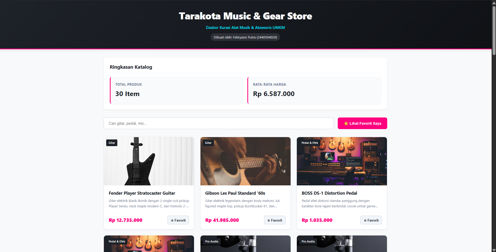
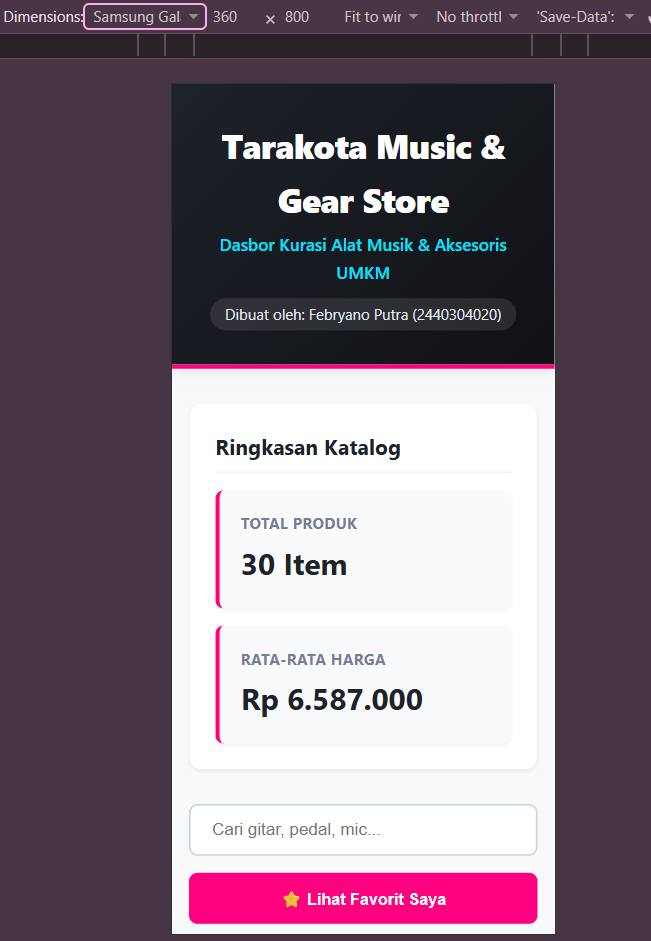

# Tarakota Music & Gear Store 🎸

Dasbor kurasi alat musik dan perlengkapan panggung UMKM yang menampilkan katalog secara _real-time_ dengan fitur pencarian cepat dan penyimpanan favorit luring (_offline_).

## 1. Identitas Mahasiswa

- **Nama:** Febryano Putra
- **NIM:** 2440304020
- **Kelas/Prodi:** Teknik Komputer / Universitas Borneo Tarakan
- **Mata Kuliah:** Pemrograman Web (PTS Semester 5)

## 2. Perhitungan Variasi Soal (NIM: 020)

Berdasarkan tiga digit terakhir NIM (020), berikut adalah penentuan variasi proyek:

- **X = 0** → Dataset & Tema: **Dashboard Produk/UMKM**
- **Y = 2** → Fitur Wajib: **Favorite/Bookmark menggunakan localStorage**
- **Z = 0** → Validasi Form: **Nama minimal 5 karakter**
- **Hitungan Challenge:** $S = 0 + 2 + 0 = 2$. Maka $C = 2 \mod 4 = 2$.
- **Challenge (C = 2):** **Loading indicator + pencarian menggunakan debounce**

## 3. Dataset & API

Aplikasi ini mengambil data REST API dari ekosistem eksternal secara _asynchronous_.

- **Endpoint Asal:** `https://dummyjson.com/products`
- **Metode:** `GET`

## 4. Cara Menjalankan Proyek

1. _Clone repository_ ini ke komputer lokal.
2. Karena proyek murni menggunakan Vanilla HTML, CSS, dan JS, Anda dapat membukanya dengan ekstensi **Live Server** di VS Code, atau meletakkan folder di dalam `htdocs`/`www` jika menggunakan XAMPP/Laragon.
3. Buka file `index.html` melalui URL `http://localhost/Pemweb-PTS`.

## 5. Bukti Tampilan (Screenshots)

> **Catatan untuk Febryano:** Jangan lupa untuk mengambil screenshot dari komputermu dan meletakkannya di folder proyek, lalu ganti teks ini dengan gambar asli!




---

## 6. Jawaban Pertanyaan Penjelasan Kode

**1. Jelaskan alur sejak halaman dibuka sampai data REST API tampil.**
Saat halaman pertama dimuat (`DOMContentLoaded`), aplikasi memanggil fungsi `initFormValidation()` lalu menjalankan `loadData()` yang ada di `app.js`. Fungsi `loadData()` memunculkan UI _Loading Spinner_, kemudian melakukan metode `fetch()` ke URL DummyJSON. Setelah respons berhasil diurai menjadi JSON dengan `await response.json()`, _spinner_ dihilangkan, kemudian data _Array_ dikirim ke fungsi `renderProducts()` untuk mencetak struktur HTML (`div`, `img`, `h3`) ke dalam kontainer DOM.

**2. Mengapa setelah fetch() selesai Anda masih perlu memeriksa response.ok?**
Karena objek `Promise` dari `fetch()` tidak akan menghasilkan nilai _reject_ (masuk ke blok `catch`) jika mendapat balasan HTTP Error (seperti `404 Not Found` atau `500 Server Error`). `fetch()` hanya menolak jika terjadi kegagalan jaringan/koneksi putus sama sekali. Pengecekan `response.ok` (status 200-299) digunakan untuk melempar _Error_ manual agar aplikasi bisa menanganinya dengan aman di UI.

**3. Pilih satu data JSON dan jelaskan bagaimana data diubah menjadi elemen DOM.**
Misalkan objek JSON menerima `{ title: "Fender Stratocaster", price: 1200, thumbnail: "img.jpg" }`. Di fungsi `renderProducts()`, program akan menggunakan `document.createElement('article')` untuk membuat kartu pembungkus. Kemudian dibuat elemen teks `const title = document.createElement('h3')` lalu diisi valuenya via `title.textContent = product.title`. Nilai JSON diinjeksikan secara murni (tidak pakai `innerHTML`) untuk menghindari eksploitasi XSS, dan disatukan (`append`) sebelum dimasukkan ke antarmuka utama.

**4. Apa yang terjadi jika internet terputus, endpoint salah, atau server mengembalikan HTTP 404/500?**
Eksekusi di dalam `try` akan terhenti dan langsung dialihkan ke blok `catch(error)`. Tampilan _loading_ akan disembunyikan dan diganti dengan pesan kegagalan (_Error State_) berwarna merah pada antarmuka. Sebuah tombol "Coba Lagi" (`btn-retry`) dimunculkan, yang mana sudah dikaitkan dengan _Event Listener_ untuk memanggil fungsi `loadData()` kembali.

**5. Jelaskan bagaimana fitur berdasarkan digit Y bekerja.**
Fitur Favorite (Y=2) ditangani oleh modul terpisah `storage.js`. Menggunakan konsep _Event Delegation_, saat pengguna mengeklik ikon Bintang di produk, fungsi `toggleFavorite()` dieksekusi. Fungsi tersebut akan membaca array produk dari `localStorage`, menggunakan `findIndex()` untuk mengecek ketersediaan produk, menambahkannya jika belum ada, lalu menyimpannya kembali ke memori lokal dalam bentuk _String JSON_ (`JSON.stringify()`).

**6. Jelaskan bagaimana validasi berdasarkan digit Z bekerja dan mengapa input tidak valid tidak boleh langsung diproses.**
Validasi (Z=0) berjalan di fungsi `initFormValidation()`. Saat _event_ `submit` tertrigger, `event.preventDefault()` langsung dijalankan untuk menghentikan pengiriman data bawaan. Sistem membaca `nameInput.value.trim().length`. Jika kurang dari 5 karakter, kelas `is-invalid` ditambahkan untuk border merah, dan pesan bantuan aksesibel disuntikkan ke DOM. Form yang tidak valid tidak boleh diproses agar data sampah (atau eksploitasi SQL) tidak dikirim dan membebani server/database.

**7. Penjelasan LocalStorage.**
Saya menggunakan `localStorage` untuk menyimpan Array of Objects produk-produk musik yang dipilih oleh pengguna. Data dibaca `getItem()` setiap kali tombol "Lihat Favorit" ditekan atau saat aplikasi merender kartu (untuk memberi status ikon bintang aktif/mati). Data diperbarui `setItem()` hanya saat pengguna mengeklik (toggle) tombol bookmark di produk. Hal ini penting untuk menyimpan preferensi pengguna agar tidak hilang saat browser dimuat ulang, tanpa harus membuat sistem _login/database backend_.

**8. Fungsi JavaScript Penting (Debounce)**

```javascript
export function debounce(func, delay = 300) {
  let timeoutId;
  return function (...args) {
    clearTimeout(timeoutId);
    timeoutId = setTimeout(() => {
      func.apply(this, args);
    }, delay);
  };
}
```
